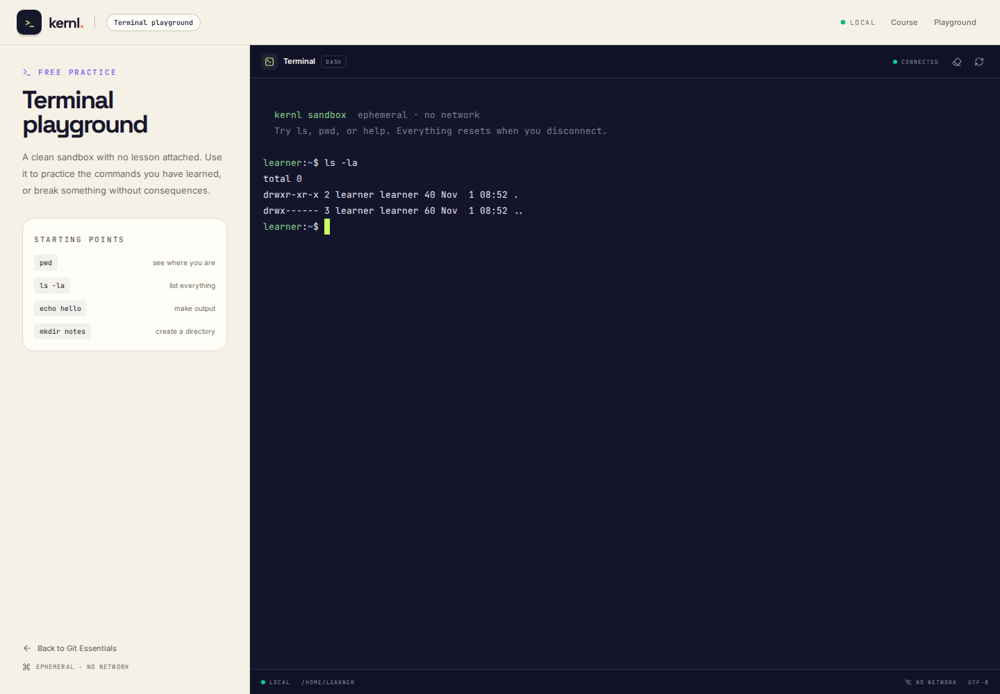

# Kernl

**Learn the terminal by actually using it.**

Three focused pages: a Git Essentials course overview, a lesson workspace with
a real Linux terminal, and a standalone terminal playground. Real bash, no
sign-up, no marketing landing pages, and no external shell service.

| Course overview | Lesson workspace | Terminal playground |
| --- | --- | --- |
|  |  |  |

## What it is

Kernl pairs short, guided lessons with an ephemeral Linux sandbox. The learner
reads an explanation, runs the command from the lesson, and sees real output
from a real shell—not a simulation or a recorded video.

The scope is exactly three pages:

- **`/` — course overview:** the Git Essentials track and its three lessons.
- **`/learn/[slug]` — lesson workspace:** guided content plus the primary
  terminal WebSocket experience.
- **`/playground` — terminal playground:** a free sandbox with no lesson
  attached, backed by the same WebSocket consumer.
- **No authentication:** no sign-in, sign-up, accounts, or learner database.
- **No external backend services:** local PostgreSQL in Docker (SQLite for
  native development), in-process Channels, and a local bubblewrap sandbox. No
  AWS, Google Cloud, hosted Redis, or remote terminal.
- **Tests wired into CI:** Django/Channels tests, Next.js unit tests, and
  Playwright browser tests.

## Stack

| Layer | Choice |
| --- | --- |
| Backend | Django 5.2 LTS, Django REST Framework, Channels 4, Uvicorn |
| Frontend | Next.js 16 App Router, React 19, TypeScript, Tailwind CSS 4 |
| Terminal | xterm.js 6 + WebSockets + a real PTY + bubblewrap |
| Containers | Docker multi-stage images + Docker Compose |
| Persistence | Local PostgreSQL in Docker; SQLite for native development |
| Workers | Uvicorn with configurable multi-worker ASGI runtime |
| Tests | pytest, pytest-django, pytest-asyncio, Vitest, Testing Library, Playwright |
| CI | GitHub Actions, including a Docker Compose E2E job |

## Architecture

Kernl is a local three-tier application:

- **Presentation:** Next.js App Router with three page types and xterm.js.
- **Application:** Django REST + Channels running under Uvicorn.
- **Coordination/data:** PostgreSQL in Docker, SQLite for native development.
- **Execution:** one disposable bubblewrap + PTY shell per terminal session.

### Runtime topology

```text
Browser
  │
  ├── HTTP :3000 ─────────────► web · Next.js standalone
  │                               │
  │                               └── server-side lesson fetch
  │                                        │
  ├── POST /api/v1/terminal/sessions/ :8000│
  └── WS /ws/terminal/<uuid>/ :8000 ───────┤
                                           ▼
                                    api · Uvicorn workers (2 by default)
                                      ├── Django REST API
                                      ├── Channels terminal consumer
                                      └── per-session PTY + bubblewrap
                                           │
                    ┌──────────────────────┴──────────────────────┐
                    ▼                                             ▼
              db · PostgreSQL 17                          sandbox · bash
              internal-only, named volume                 read-only rootfs,
                                                          writable /home/learner
```

- The browser talks to the API directly for ticket creation and WebSockets.
- Next.js server components call the API over the internal Compose network.
- PostgreSQL is never exposed to the host.
- Only `127.0.0.1:3000` and `127.0.0.1:8000` are published.
- The shell itself has no host network namespace.

### Page types and routes

| Page type | Route | Responsibility |
| --- | --- | --- |
| Course overview | `/` | Git Essentials outline and links into lessons |
| Lesson workspace | `/learn/[slug]` | Lesson content + primary terminal experience |
| Terminal playground | `/playground` | Free sandbox, no lesson attached |

There are three **page types**, not one page per lesson. The dynamic
`/learn/[slug]` route renders the same component for the three Git lesson
records. API routes, WebSocket routes, and framework 404/error states are not
product pages.

### Backend components

| Component | Location | Responsibility |
| --- | --- | --- |
| Catalog API | `backend/apps/catalog/` | Course/module/lesson models, seed data, lesson serializer |
| Terminal API | `backend/apps/terminal/views.py` | Issues short-lived one-use tickets |
| WebSocket consumer | `backend/apps/terminal/consumers.py` | Claims tickets, starts PTY, handles JSON protocol, cleanup |
| Sandbox runtime | `backend/apps/terminal/services/bubblewrap.py` | bubblewrap args, PTY lifecycle, resize, process-group teardown |
| ASGI app | `backend/config/asgi.py` | HTTP + origin-validated WebSocket routing |
| Health | `backend/apps/core/views.py` | DB check and cached real bubblewrap probe |
| Container bootstrap | `backend/docker/start-api.sh` | migrate, seed, start Uvicorn workers |

### Frontend components

| Component | Location | Responsibility |
| --- | --- | --- |
| Terminal panel | `frontend/src/components/lesson/terminal-panel.tsx` | xterm.js, fit/resize, ticket POST, WebSocket JSON protocol, restart/error UI |
| Lesson workspace | `frontend/src/components/lesson/lesson-workspace.tsx` | Sidebar outline, lesson rendering, terminal integration |
| API client | `frontend/src/lib/api.ts` | Typed lesson fetch, ticket creation, WS URL derivation |
| Page shell | `frontend/src/app/` | Three page routes + loading/error/not-found states |

### Data model

```text
Course 1──* Module 1──* Lesson
                            │
                            └──* TerminalSession (optional FK, SET_NULL)

TerminalSession
  id, lesson, created_at, expires_at,
  connected_at, closed_at, close_reason
```

- Only **Git Essentials** is seeded: 2 modules and 3 lessons as shown in the UI.
- A terminal ticket is single-use and does not require a learner account.
- Commands and terminal output are **never** written to the database.
- There are no auth, profile, progress, or admin tables.

### Request flow

1. The browser requests a page from Next.js on `:3000`.
2. Next.js server-side fetches lesson data from `http://api:8000` in Docker.
3. The lesson page mounts xterm.js and POSTs to
   `/api/v1/terminal/sessions/`.
4. The API creates a UUID ticket with a 30-minute claim TTL.
5. The browser opens `/ws/terminal/<uuid>/`.
6. Channels validates the origin and atomically claims the ticket with
   `SELECT ... FOR UPDATE`.
7. The consumer starts bash in a new PTY inside bubblewrap and streams output.
8. Disconnect, idle timeout, or maximum lifetime kills the process group,
   removes the workspace, and records the close reason.

HTTP and WebSocket requests can be handled by different Uvicorn workers because
the ticket and session state live in PostgreSQL.

## Quickstart with Docker

### Prerequisites

- Docker Engine **27+** with Compose v2
- A Linux Docker host (bubblewrap runs as a nested sandbox inside the API
  container)

No Python, Node.js, or local bubblewrap installation is required on the host.

### Start the stack

```bash
docker compose up --build
# or:
make docker-up
```

Open **http://localhost:3000**.

The first start migrates and seeds PostgreSQL in a named volume. The API
container runs two Uvicorn workers by default, so HTTP ticket creation and the
WebSocket can land on different workers and still see the same session. The
stack is ready when the database, API, and web containers report `healthy`:

```bash
docker compose ps
docker compose logs -f --tail=100
```

Useful commands:

```bash
make docker-check   # boot a real shell inside the API container
make docker-e2e     # Playwright against the Compose stack
make docker-down    # stop the stack, keep the database volume
make docker-reset   # stop and delete the database volume
```

Optional overrides live in `.env.example`; copy it to `.env` if you want to
change the secret, allowed hosts, or browser-facing URLs.

### Compose architecture

```text
docker compose
├── db         PostgreSQL 17, internal-only, named volume
├── api        Uvicorn workers + Channels + bubblewrap sandbox
│              non-root uid 10001, read-only rootfs, cap_drop ALL
│              tmpfs /tmp, persistent connections to db
└── web        Next.js standalone server
               non-root node user, read-only rootfs
               exposed at 127.0.0.1:3000
```

Startup order is `db healthy → api migrate/seed → api healthy → web`.
Only `127.0.0.1:3000` and `127.0.0.1:8000` are published. The web container
reaches the API over the private Compose network at `http://api:8000`; Postgres
is never exposed to the host.

### Scaling model

- **Two Uvicorn workers by default**, configurable with `WEB_CONCURRENCY`.
- Session tickets live in PostgreSQL, so HTTP and WebSocket traffic can be
  served by different workers without sticky sessions.
- Each terminal is an independent PTY process. The true capacity ceiling is
  terminal processes, CPU, memory, and file descriptors—not WebSocket
  connections. The Compose API has explicit PID/memory limits, and
  `TERMINAL_MAX_SESSIONS` bounds concurrent tickets.
- Increase `WEB_CONCURRENCY` and the terminal/process limits together; do not
  raise only one.
- For multiple host replicas, add a WebSocket-capable reverse proxy in front of
  the API and increase PostgreSQL connection capacity. The application keeps no
  per-worker terminal session state.

### Why the API has relaxed Docker security profiles

The Compose API service uses:

```yaml
security_opt:
  - no-new-privileges:true
  - seccomp=unconfined
  - apparmor=unconfined
  - systempaths=unconfined
```

Bubblewrap must create nested user/PID/mount/network namespaces and mount a
private `/proc` inside a container that already has a Docker seccomp profile.
The default Docker profiles block those operations. The container itself is
still hardened:

- runs as unprivileged uid/gid `10001`
- `read_only: true`
- `cap_drop: ALL`
- `no-new-privileges:true`
- no Docker socket, host source bind, or host home mount
- `/tmp` is an ephemeral, size-limited tmpfs
- only the PostgreSQL data volume is writable

The inner shell still has all of the bubblewrap guarantees described below.
This relaxed outer profile is a deliberate Docker-on-Linux tradeoff, not a
public multi-tenant hosting configuration.

Docker Desktop on macOS/Windows may not allow nested unprivileged user
namespaces; run the Compose stack on a Linux Docker host.

### Native development without Docker

The original host workflow is still available if you prefer hot reload:

```bash
make setup   # venv + Python deps + npm ci + migrations + seed data
make dev     # Django on :8000 and Next.js on :3000
```

Or manually:

```bash
python3 -m venv backend/.venv
backend/.venv/bin/pip install -r backend/requirements-dev.txt
cd backend
.venv/bin/python manage.py migrate
.venv/bin/python manage.py seed_catalog --prune
.venv/bin/uvicorn config.asgi:application --host 127.0.0.1 --port 8000

# Frontend (another terminal)
cd frontend
npm ci
npm run dev
```

Native development requires Python 3.13+, Node.js 22+, and `bubblewrap`
(`sudo apt-get install bubblewrap` on Debian/Ubuntu). If bubblewrap is missing,
the terminal fails closed rather than running an unconfined shell.

## How the terminal works

```
Browser
  Next.js App Router
    ├── GET lesson content ──────────────────┐
    │                                        v
    │                                  Django REST API
    │                                        │
    │  POST /api/v1/terminal/sessions/       │
    │  → single-use ticket, 30 min TTL       │
    │                                        │
    └── WebSocket /ws/terminal/<uuid>/       │
              │                              │
              v                              │
        Django Channels consumer ────────────┘
              │
              ├── validates origin
              ├── claims ticket exactly once
              ├── spawns PTY + bubblewrap bash
              ├── streams bytes ↔ xterm.js
              └── kills the process group + deletes the workspace
```

1. The lesson page mounts xterm.js and requests a terminal ticket over HTTP.
2. The ticket is a UUID with a short TTL and is stored in the configured database
   (SQLite for native development, PostgreSQL in Docker).
3. The browser opens a WebSocket with that UUID.
4. `TerminalConsumer` validates the origin, atomically claims the ticket, and
   starts a PTY-backed bash process inside a bubblewrap sandbox.
5. Output and input are JSON-framed. Resize events keep the PTY in sync with
   xterm.js.
6. On disconnect, idle timeout, or maximum lifetime, the process group is
   killed and the session directory is deleted.

### WebSocket protocol

Client → server:

```json
{"type": "input", "data": "ls -la\r"}
{"type": "resize", "cols": 120, "rows": 32}
{"type": "ping"}
```

Server → client:

```json
{"type": "ready", "cwd": "/home/learner"}
{"type": "output", "data": "README.md  projects\r\n"}
{"type": "error", "code": "idle_timeout", "message": "..."}
{"type": "exit", "code": 0}
{"type": "pong"}
```

Framing and limits:

- JSON text frames in both directions.
- Input limited to **16 KB** per message.
- Terminal output limited to **2 MB** per session.
- Resize is clamped to 400×200.
- Close reasons include `client_disconnect`, `shell_exit`, `idle_timeout`,
  `max_lifetime`, `output_limit`, `sandbox_unavailable`, and `read_error`.
- WebSocket close codes include `4404` (invalid/used ticket), `1008` (output
  limit), `1011` (sandbox failure), `4001` (idle), and `4002` (max lifetime).

## Sandbox security model

This is a **single-user, local-first** application. There is deliberately no
authentication, so the development server binds to `127.0.0.1` by default.

The shell is isolated with bubblewrap:

- `--unshare-all`: private user, PID, network, IPC, UTS, and cgroup namespaces.
- Network access is unshared; outbound connections fail.
- `/usr`, `/bin`, `/lib`, and a minimal `/etc` are mounted **read-only**.
- Only `/home/learner` is writable. Every lesson starts with its own seeded
  files and the directory is deleted when the session ends.
- The host home directory, `/etc` secrets, Docker socket, and project source are
  not mounted inside the sandbox.
- `--die-with-parent` plus process-group cleanup prevents orphaned shells.
- Resource limits: 8 MB max file, 128 file descriptors, 2 MB output per session,
  10 min idle timeout, 20 min maximum lifetime.
- Server-side guardrails: single-use tickets, origin validation, a global
  session cap, and ticket throttling.

**Do not expose this app directly to the public internet.** Running arbitrary
commands for anonymous users requires authentication, per-user quotas, a
separate sandbox host, auditing, and a defensive reverse proxy. The local
sandbox is appropriate for the challenge and for local learning; it is not a
multi-tenant hosting design.

The only terminal data persisted is the session UUID, optional lesson
reference, timestamps, and close reason. Input and output are never written to
the database.

## API

| Method | Path | Purpose |
| --- | --- | --- |
| `GET` | `/api/health/` | Database health and a cached real bubblewrap probe |
| `GET` | `/api/v1/catalog/lessons/<slug>/` | Lesson content, outline, prev/next |
| `POST` | `/api/v1/terminal/sessions/` | Create a one-time terminal ticket |

`/api/health/` returns `200` when PostgreSQL is reachable, with
`status: "degraded"` if the cached bubblewrap probe fails. It returns `503`
only when the database itself is unavailable. This lets the web container start
and show a useful terminal error even if the host sandbox cannot boot.

The ticket endpoint accepts an optional `lesson_slug`. Lesson pages send it so
the sandbox starts with that lesson's files; the playground omits it and starts
with an empty home directory.

```json
POST /api/v1/terminal/sessions/
{"lesson_slug": "your-first-repository"}

201 Created
{
  "id": "…uuid…",
  "expires_at": "…",
  "websocket_path": "/ws/terminal/…uuid…/"
}
```

The ticket is single-use. The WebSocket route validates the browser origin, and
the consumer claims the ticket atomically with `SELECT ... FOR UPDATE`.

Example:

```bash
curl -s http://127.0.0.1:8000/api/health/
curl -s http://127.0.0.1:8000/api/v1/catalog/lessons/your-first-repository/ | jq
curl -s -X POST http://127.0.0.1:8000/api/v1/terminal/sessions/ \
  -H 'Content-Type: application/json' \
  -d '{"lesson_slug":"your-first-repository"}' | jq
```

## Tests

### Test matrix

| Layer | Coverage | Command |
| --- | --- | --- |
| Backend | API, ticket lifecycle, WS protocol, idle/output limits, concurrency, real bwrap | `make test-backend` |
| Frontend | Rendering, XSS-safe text, command wiring, WebSocket URL | `make test-frontend` |
| Browser/UI | 3-page flow, terminals, concurrency, WCAG, responsive, 404, console errors | `make docker-e2e` |
| Postgres path | The same backend suite against PostgreSQL | CI backend job |
| Full local gate | Lint + unit + build + Docker + Playwright | `make verify` |


```bash
make test           # backend + frontend
make lint           # Ruff, ESLint, TypeScript, Prettier
make e2e-install    # once per machine
make e2e            # Playwright (starts native servers)
make docker-e2e     # Playwright against the running Compose stack
make verify         # Full lint + unit + build + Docker + E2E suite
```

Current suites:

- **20 backend tests** covering lesson delivery, session issuing, ticket
  lifecycle, origin rejection, concurrent WebSocket sessions, input validation,
  idle timeout, output limits, and real bubblewrap isolation (network + filesystem).
- **7 frontend tests** covering content rendering, XSS-safe rich text, command
  execution wiring, and WebSocket URL construction.
- **11 Playwright tests** covering the three-page flow, lesson and playground
  terminals, three isolated concurrent sessions, WCAG accessibility scans,
  mobile overflow checks, keyboard focus, console errors, and the 404 page.

The E2E terminal test automatically skips when the host cannot run bubblewrap.
Backend sandbox tests do the same, so the suite remains portable.

### CI/CD

`.github/workflows/ci.yml` runs three jobs on every push and pull request:

1. **Backend** — Ruff, Django checks, migration drift check, and pytest against
   PostgreSQL with coverage and artifact upload.
2. **Frontend** — npm install from lockfile, ESLint, TypeScript, Vitest, Prettier
   check, and a production Next.js build.
3. **E2E** — builds and starts the Docker Compose stack, verifies the API,
   `/api/health/`, `check_terminal`, the course/lesson/playground routes, then
   runs Playwright against the containers with Chromium.

No hosted services, Docker registry, or secrets are required. The CI backend
job uses a local PostgreSQL service; Docker E2E uses the Compose PostgreSQL
database and two Uvicorn workers.

Deployment is intentionally local: the project does not push to a cloud
provider because the brief forbids external backend resources. A production CD
target would publish the two images and provide a WebSocket-capable reverse
proxy in front of the API; the application state model already supports that.

## Configuration

### Docker Compose

| Variable | Default | Notes |
| --- | --- | --- |
| `DJANGO_SECRET_KEY` | local-only value | Change in `.env` for any shared host |
| `DJANGO_ALLOWED_HOSTS` | `localhost,127.0.0.1,api` | `api` is the Compose service name |
| `CORS_ALLOWED_ORIGINS` | `http://localhost:3000,...` | Browser origin for ticket POSTs |
| `NEXT_PUBLIC_API_URL` | `http://127.0.0.1:8000` | Build arg; baked into browser JS |
| `NEXT_PUBLIC_WS_URL` | `ws://127.0.0.1:8000` | Build arg; baked into browser JS |
| `API_URL` | `http://api:8000` | Runtime server-side lesson fetch |
| `POSTGRES_PASSWORD` | local-only value | Local PostgreSQL password |
| `DATABASE_URL` | `postgres://kernl:...@db:5432/kernl` | Internal Compose network |
| `DB_CONN_MAX_AGE` | `60` | Persistent PostgreSQL connections |
| `WEB_CONCURRENCY` | `2` | Uvicorn worker processes |
| `TERMINAL_WORK_ROOT` | `/tmp/kernl-terminal` | Ephemeral tmpfs |

`NEXT_PUBLIC_*` values are inlined by Next.js at build time. If you change the
public host or port, update `.env` and rebuild the `web` image:

```bash
docker compose build web
docker compose up -d web
```

### Backend

| Variable | Default | Notes |
| --- | --- | --- |
| `DJANGO_DEBUG` | `true` | Use `false` in production |
| `DJANGO_SECRET_KEY` | dev-only value | Change outside local development |
| `DJANGO_ALLOWED_HOSTS` | `localhost,127.0.0.1` | Also used for WebSocket origins |
| `DATABASE_URL` | `sqlite:///backend/db.sqlite3` | Native default; Docker uses Postgres |
| `CORS_ALLOWED_ORIGINS` | `http://localhost:3000,...` | Browser origin for ticket POSTs |
| `TERMINAL_SESSION_TTL_SECONDS` | `1800` | Time allowed to claim a ticket |
| `TERMINAL_IDLE_TIMEOUT_SECONDS` | `600` | No-input timeout |
| `TERMINAL_MAX_LIFETIME_SECONDS` | `1200` | Hard session cap |
| `TERMINAL_MAX_SESSIONS` | `25` | Global concurrent ticket cap |
| `TERMINAL_SESSION_THROTTLE` | `20/min` | DRF throttle for ticket creation |

### Frontend

| Variable | Default | Notes |
| --- | --- | --- |
| `API_URL` | `http://127.0.0.1:8000` (native), `http://api:8000` (Docker) | Server-side lesson fetch |
| `NEXT_PUBLIC_API_URL` | `http://127.0.0.1:8000` | Browser ticket POST |
| `NEXT_PUBLIC_WS_URL` | derived from API URL | WebSocket origin override |

## Troubleshooting

### Terminal says sandbox unavailable

```bash
make docker-check
curl -s http://127.0.0.1:8000/api/health/
docker compose logs api
```

The API must run on a Linux host with bubblewrap and unprivileged user
namespaces. Docker Desktop on macOS/Windows may block nested namespaces.

### Port already in use

Kernl publishes `127.0.0.1:3000` and `127.0.0.1:8000`. Stop the conflicting
process or change the published ports and the corresponding
`NEXT_PUBLIC_API_URL` / `NEXT_PUBLIC_WS_URL` build args.

### Reset the database

```bash
make docker-reset
make docker-up
```

### Rebuild browser-facing URLs

`NEXT_PUBLIC_*` values are baked into the web bundle. After changing them:

```bash
docker compose build web
docker compose up -d web
```

## Lesson content

The Git Essentials track lives in `backend/apps/catalog/seed_data.py` so it can
be reviewed and versioned with the code. The seed command is idempotent:

```bash
cd backend
.venv/bin/python manage.py seed_catalog --prune
```

Edit the lesson copy in that file, then run the seed command again.

Only **Git Essentials** is seeded: three guided lessons with per-lesson starter
files and the matching lesson outline in the page sidebar.

## Project layout

```text
compose.yaml                 Postgres + multi-worker API + web
.github/workflows/ci.yml     Backend, frontend, and Docker E2E pipelines
backend/
  Dockerfile                 Python + bubblewrap production image
  docker/start-api.sh        migrate, seed, then start Uvicorn workers
  config/                    Django settings, ASGI, URLs
  apps/catalog/              Git lessons, outline API, seed data
  apps/terminal/             Session tickets, Channels consumer, bwrap PTY
  apps/core/                 Health + real sandbox probe
  tests/                     API + WebSocket + real-shell integration tests
frontend/
  Dockerfile                 Next.js standalone multi-stage image
  src/app/page.tsx           Git Essentials course overview
  src/app/(lesson)/learn/    Lesson workspace + terminal
  src/app/(lesson)/playground/ Standalone terminal playground
  src/components/lesson/     xterm panel, command blocks, lesson renderer
  src/lib/                   Typed API client, content types, design tokens
  e2e/                       Flow, terminal, accessibility, and responsive tests
scripts/                     Native dev + E2E bootstrap scripts
docs/screenshots/            Current three-page screenshots
```

## Design decisions & tradeoffs

- **Exactly three pages.** The course overview links into the three Git
  lessons; the lesson workspace and playground both use the same terminal
  WebSocket consumer. There are no marketing pages, auth screens, or extra
  product surfaces.
- **Docker for packaging, bubblewrap for execution.** Compose gives reproducible
  images, a read-only runtime, healthchecks, and one-command startup. Bubblewrap
  still creates a fresh namespace and filesystem for every terminal session;
  Docker is not used as a per-command sandbox. The tradeoff is a Linux host
  requirement and a deliberately relaxed outer seccomp/AppArmor profile.
- **Real PTY, not a fake shell.** Commands, colors, job control, history, and
  signals behave like a terminal because it is a terminal.
- **Direct WebSocket rather than proxying through Next.js.** This keeps the
  Channels consumer simple and avoids buffering issues in the Node layer. CORS
  and origin validation are configured explicitly.
- **PostgreSQL + multiple Uvicorn workers in Docker.** Session tickets are
  database-backed, so HTTP and WebSocket requests can be handled by different
  workers. Native development still defaults to SQLite. The in-memory Channels
  layer is only used for local lifecycle; this consumer does not depend on
  cross-worker group messaging.
- **No auth.** Deliberate challenge constraint. The app is not intended to be
  exposed publicly.
- **Progress is not persisted.** The progress bar reflects lesson position, not
  a learner account. No account or progress data is stored.

## License

MIT
