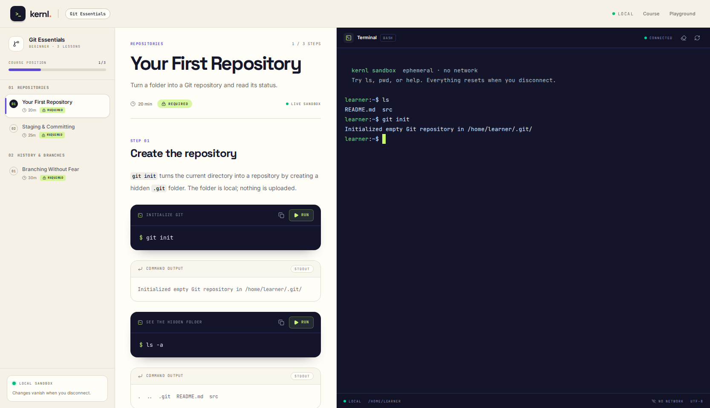
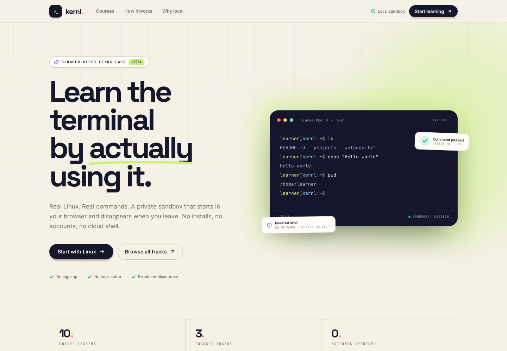
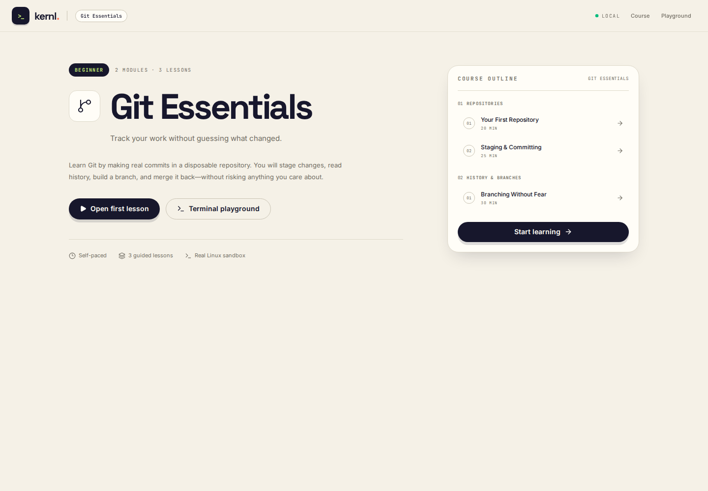

# Kernl

**Learn the terminal by actually using it.**

A local-first, Codecademy-style learning app with a real Linux terminal in the
browser. Three pages, real bash, no sign-up, and no external shell service.



## What it is

Kernl pairs short, guided lessons with an ephemeral Linux sandbox. The learner
reads an explanation, runs the command from the lesson, and sees real output
from a real shell—not a simulation or a recorded video.

The challenge scope is intentionally tight:

- **3 pages:** `/` (catalog), `/courses/[slug]` (syllabus), `/learn/[slug]`
  (lesson + terminal).
- **No authentication:** no sign-in, sign-up, accounts, or learner database.
- **No external backend services:** SQLite, in-memory Channels, and a local
  bubblewrap sandbox. No AWS, Google Cloud, hosted Redis, or remote terminal.
- **Tests wired into CI:** Django/Channels tests, Next.js unit tests, and
  Playwright browser tests.

### Screenshots

| Course library | Course syllabus |
| --- | --- |
|  |  |

## Stack

| Layer | Choice |
| --- | --- |
| Backend | Django 5.2 LTS, Django REST Framework, Channels 4, Daphne |
| Frontend | Next.js 16 App Router, React 19, TypeScript, Tailwind CSS 4 |
| Terminal | xterm.js 6 + WebSockets + a real PTY + bubblewrap |
| Containers | Docker multi-stage images + Docker Compose |
| Persistence | SQLite by default; any `DATABASE_URL` supported by Django |
| Tests | pytest, pytest-django, pytest-asyncio, Vitest, Testing Library, Playwright |
| CI | GitHub Actions, including a Docker Compose E2E job |

## Quickstart with Docker

### Prerequisites

- Docker Engine **27+** with Compose v2
- A Linux Docker host (bubblewrap runs as a nested sandbox inside the API
  container)

No Python, Node.js, or local bubblewrap installation is required on the host.

### Start the stack

```bash
docker compose up --build
# or:
make docker-up
```

Open **http://localhost:3000**.

The first start migrates and seeds the SQLite database inside a named volume.
The stack is ready when both containers report `healthy`:

```bash
docker compose ps
docker compose logs -f --tail=100
```

Useful commands:

```bash
make docker-check   # boot a real shell inside the API container
make docker-down    # stop the stack, keep the database volume
make docker-reset   # stop and delete the database volume
```

Optional overrides live in `.env.example`; copy it to `.env` if you want to
change the secret, allowed hosts, or browser-facing URLs.

### Compose architecture

```text
docker compose
├── api-init   one-shot chown of the SQLite volume, exits
├── api        Daphne + Channels + bubblewrap sandbox
│              non-root uid 10001, read-only rootfs, cap_drop ALL
│              named volume /app/data, tmpfs /tmp
└── web        Next.js standalone server
               non-root node user, read-only rootfs
               exposed at 127.0.0.1:3000
```

Only `127.0.0.1:3000` and `127.0.0.1:8000` are published. The web container
reaches the API over the private Compose network at `http://api:8000`.

### Why the API has relaxed Docker security profiles

The Compose API service uses:

```yaml
security_opt:
  - no-new-privileges:true
  - seccomp=unconfined
  - apparmor=unconfined
  - systempaths=unconfined
```

Bubblewrap must create nested user/PID/mount/network namespaces and mount a
private `/proc` inside a container that already has a Docker seccomp profile.
The default Docker profiles block those operations. The container itself is
still hardened:

- runs as unprivileged uid/gid `10001`
- `read_only: true`
- `cap_drop: ALL`
- `no-new-privileges:true`
- no Docker socket, host source bind, or host home mount
- `/tmp` is an ephemeral, size-limited tmpfs
- only the SQLite volume is writable

The inner shell still has all of the bubblewrap guarantees described below.
This relaxed outer profile is a deliberate Docker-on-Linux tradeoff, not a
public multi-tenant hosting configuration.

Docker Desktop on macOS/Windows may not allow nested unprivileged user
namespaces; run the Compose stack on a Linux Docker host.

### Native development without Docker

The original host workflow is still available if you prefer hot reload:

```bash
make setup   # venv + Python deps + npm ci + migrations + seed data
make dev     # Django on :8000 and Next.js on :3000
```

Or manually:

```bash
python3 -m venv backend/.venv
backend/.venv/bin/pip install -r backend/requirements-dev.txt
cd backend
.venv/bin/python manage.py migrate
.venv/bin/python manage.py seed_catalog --prune
.venv/bin/daphne -b 127.0.0.1 -p 8000 config.asgi:application

# Frontend (another terminal)
cd frontend
npm ci
npm run dev
```

Native development requires Python 3.13+, Node.js 22+, and `bubblewrap`
(`sudo apt-get install bubblewrap` on Debian/Ubuntu). If bubblewrap is missing,
the terminal fails closed rather than running an unconfined shell.

## How the terminal works

```
Browser
  Next.js App Router
    ├── GET catalog / lesson content ────────┐
    │                                        v
    │                                  Django REST API
    │                                        │
    │  POST /api/v1/terminal/sessions/       │
    │  → single-use ticket, 30 min TTL       │
    │                                        │
    └── WebSocket /ws/terminal/<uuid>/       │
              │                              │
              v                              │
        Django Channels consumer ────────────┘
              │
              ├── validates origin
              ├── claims ticket exactly once
              ├── spawns PTY + bubblewrap bash
              ├── streams bytes ↔ xterm.js
              └── kills the process group + deletes the workspace
```

1. The lesson page mounts xterm.js and requests a terminal ticket over HTTP.
2. The ticket is a UUID with a short TTL and is stored in SQLite.
3. The browser opens a WebSocket with that UUID.
4. `TerminalConsumer` validates the origin, atomically claims the ticket, and
   starts a PTY-backed bash process inside a bubblewrap sandbox.
5. Output and input are JSON-framed. Resize events keep the PTY in sync with
   xterm.js.
6. On disconnect, idle timeout, or maximum lifetime, the process group is
   killed and the session directory is deleted.

### WebSocket protocol

Client → server:

```json
{"type": "input", "data": "ls -la\r"}
{"type": "resize", "cols": 120, "rows": 32}
{"type": "ping"}
```

Server → client:

```json
{"type": "ready", "cwd": "/home/learner"}
{"type": "output", "data": "README.md  projects\r\n"}
{"type": "error", "code": "idle_timeout", "message": "..."}
{"type": "exit", "code": 0}
{"type": "pong"}
```

## Sandbox security model

This is a **single-user, local-first** application. There is deliberately no
authentication, so the development server binds to `127.0.0.1` by default.

The shell is isolated with bubblewrap:

- `--unshare-all`: private user, PID, network, IPC, UTS, and cgroup namespaces.
- Network access is unshared; outbound connections fail.
- `/usr`, `/bin`, `/lib`, and a minimal `/etc` are mounted **read-only**.
- Only `/home/learner` is writable. Every lesson starts with its own seeded
  files and the directory is deleted when the session ends.
- The host home directory, `/etc` secrets, Docker socket, and project source are
  not mounted inside the sandbox.
- `--die-with-parent` plus process-group cleanup prevents orphaned shells.
- Resource limits: 8 MB max file, 128 file descriptors, 2 MB output per session,
  10 min idle timeout, 20 min maximum lifetime.
- Server-side guardrails: single-use tickets, origin validation, a global
  session cap, and per-IP ticket throttling.

**Do not expose this app directly to the public internet.** Running arbitrary
commands for anonymous users requires authentication, per-user quotas, a
separate sandbox host, auditing, and a defensive reverse proxy. The local
sandbox is appropriate for the challenge and for local learning; it is not a
multi-tenant hosting design.

The only data persisted about a terminal is a UUID, timestamps, and a close
reason. Input and output are never written to the database.

## API

| Method | Path | Purpose |
| --- | --- | --- |
| `GET` | `/api/health/` | Database and sandbox health |
| `GET` | `/api/v1/catalog/courses/` | Published courses |
| `GET` | `/api/v1/catalog/courses/<slug>/` | Course + modules + lessons |
| `GET` | `/api/v1/catalog/lessons/<slug>/` | Lesson content + prev/next |
| `POST` | `/api/v1/terminal/sessions/` | Create a one-time terminal ticket |

Example:

```bash
curl -s http://127.0.0.1:8000/api/health/
curl -s http://127.0.0.1:8000/api/v1/catalog/courses/ | jq
curl -s -X POST http://127.0.0.1:8000/api/v1/terminal/sessions/ \
  -H 'Content-Type: application/json' \
  -d '{"lesson_slug":"working-with-linux-commands"}' | jq
```

## Tests

```bash
make test           # backend + frontend
make lint           # Ruff, ESLint, TypeScript, Prettier
make e2e-install    # once per machine
make e2e            # Playwright (starts native servers)

# Run Playwright against an already-running Docker stack:
PLAYWRIGHT_BASE_URL=http://localhost:3000 \
  E2E_HEALTH_URL=http://127.0.0.1:8000/api/health/ \
  npm --prefix frontend run e2e
```

Current suites:

- **19 backend tests** covering the catalog API, session issuing, ticket
  lifecycle, origin rejection, WebSocket I/O, input validation, and real
  bubblewrap isolation (network + filesystem).
- **10 frontend tests** covering content rendering, XSS-safe rich text, command
  execution wiring, course cards, and URL/format helpers.
- **2 Playwright tests** covering the full three-page navigation flow, a command
  round-trip through xterm.js, and executable lesson scripts inside the sandbox.

The E2E terminal test automatically skips when the host cannot run bubblewrap.
Backend sandbox tests do the same, so the suite remains portable.

### CI

`.github/workflows/ci.yml` runs three jobs on every push and pull request:

1. **Backend** — Ruff, Django checks, migration drift check, pytest with
   coverage, artifact upload.
2. **Frontend** — npm install from lockfile, ESLint, TypeScript, Vitest, Prettier
   check, and a production Next.js build.
3. **E2E** — builds and starts the Docker Compose stack, verifies the API,
   `/api/health/`, `check_terminal`, and all three pages, then runs Playwright
   against the containers with Chromium.

No hosted services, Docker registry, or secrets are required. Tests use SQLite
and the in-memory Channels layer.

## Configuration

### Docker Compose

| Variable | Default | Notes |
| --- | --- | --- |
| `DJANGO_SECRET_KEY` | local-only value | Change in `.env` for any shared host |
| `DJANGO_ALLOWED_HOSTS` | `localhost,127.0.0.1,api` | `api` is the Compose service name |
| `CORS_ALLOWED_ORIGINS` | `http://localhost:3000,...` | Browser origin for ticket POSTs |
| `NEXT_PUBLIC_API_URL` | `http://127.0.0.1:8000` | Build arg; baked into browser JS |
| `NEXT_PUBLIC_WS_URL` | `ws://127.0.0.1:8000` | Build arg; baked into browser JS |
| `API_URL` | `http://api:8000` | Runtime server-side catalog fetches |
| `DATABASE_URL` | `sqlite:////app/data/db.sqlite3` | Named volume |
| `TERMINAL_WORK_ROOT` | `/tmp/kernl-terminal` | Ephemeral tmpfs |

`NEXT_PUBLIC_*` values are inlined by Next.js at build time. If you change the
public host or port, update `.env` and rebuild the `web` image:

```bash
docker compose build web
docker compose up -d web
```

### Backend

| Variable | Default | Notes |
| --- | --- | --- |
| `DJANGO_DEBUG` | `true` | Use `false` in production |
| `DJANGO_SECRET_KEY` | dev-only value | Change outside local development |
| `DJANGO_ALLOWED_HOSTS` | `localhost,127.0.0.1` | Also used for WebSocket origins |
| `DATABASE_URL` | `sqlite:///backend/db.sqlite3` | Any Django-supported database |
| `CORS_ALLOWED_ORIGINS` | `http://localhost:3000,...` | Browser origin for ticket POSTs |
| `TERMINAL_SESSION_TTL_SECONDS` | `1800` | Time allowed to claim a ticket |
| `TERMINAL_IDLE_TIMEOUT_SECONDS` | `600` | No-input timeout |
| `TERMINAL_MAX_LIFETIME_SECONDS` | `1200` | Hard session cap |
| `TERMINAL_MAX_SESSIONS` | `25` | Global concurrent ticket cap |
| `TERMINAL_SESSION_THROTTLE` | `20/min` | DRF throttle for ticket creation |

### Frontend

| Variable | Default | Notes |
| --- | --- | --- |
| `API_URL` | `http://127.0.0.1:8000` | Server-side catalog fetches |
| `NEXT_PUBLIC_API_URL` | `http://127.0.0.1:8000` | Browser ticket POST |
| `NEXT_PUBLIC_WS_URL` | derived from API URL | WebSocket origin override |

## Course content

The catalog lives in `backend/apps/catalog/seed_data.py` so it can be reviewed
and versioned with the code. The seed command is idempotent:

```bash
cd backend
.venv/bin/python manage.py seed_catalog --prune
```

To edit content through Django admin:

```bash
cd backend
.venv/bin/python manage.py createsuperuser
# visit http://127.0.0.1:8000/admin/
```

Three tracks are included: **Linux Foundations**, **Git Essentials**, and
**Bash Scripting**—10 guided lessons with per-lesson starter files.

## Project layout

```text
compose.yaml                 API + web + one-shot volume initializer
backend/
  Dockerfile                 Python + bubblewrap production image
  docker/start-api.sh        migrate, seed, then start Daphne
  config/                    Django settings, ASGI, URLs
  apps/catalog/              Courses, modules, lessons, API, seed data
  apps/terminal/             Session tickets, Channels consumer, bwrap PTY
  tests/                     API + WebSocket + real-shell integration tests
frontend/
  Dockerfile                 Next.js standalone multi-stage image
  src/app/(site)/            Home + course pages
  src/app/(lesson)/          Lesson workspace
  src/components/lesson/     xterm panel, command blocks, lesson renderer
  src/lib/                   Typed API client, content types, design tokens
  e2e/                       Playwright flows
```

## Design decisions & tradeoffs

- **Docker for packaging, bubblewrap for execution.** Compose gives reproducible
  images, a read-only runtime, healthchecks, and one-command startup. Bubblewrap
  still creates a fresh namespace and filesystem for every terminal session;
  Docker is not used as a per-command sandbox. The tradeoff is a Linux host
  requirement and a deliberately relaxed outer seccomp/AppArmor profile.
- **Real PTY, not a fake shell.** Commands, colors, job control, history, and
  signals behave like a terminal because it is a terminal.
- **Direct WebSocket rather than proxying through Next.js.** This keeps the
  Channels consumer simple and avoids buffering issues in the Node layer. CORS
  and origin validation are configured explicitly.
- **SQLite + in-memory Channels.** Perfect for a local single-process app. For
  multiple ASGI workers, replace the channel layer with a local Redis instance.
- **No auth.** Deliberate challenge constraint. The app is not intended to be
  exposed publicly.
- **Progress is not persisted.** The progress bar reflects lesson position, not
  a learner account. No account or progress data is stored.

## License

MIT
